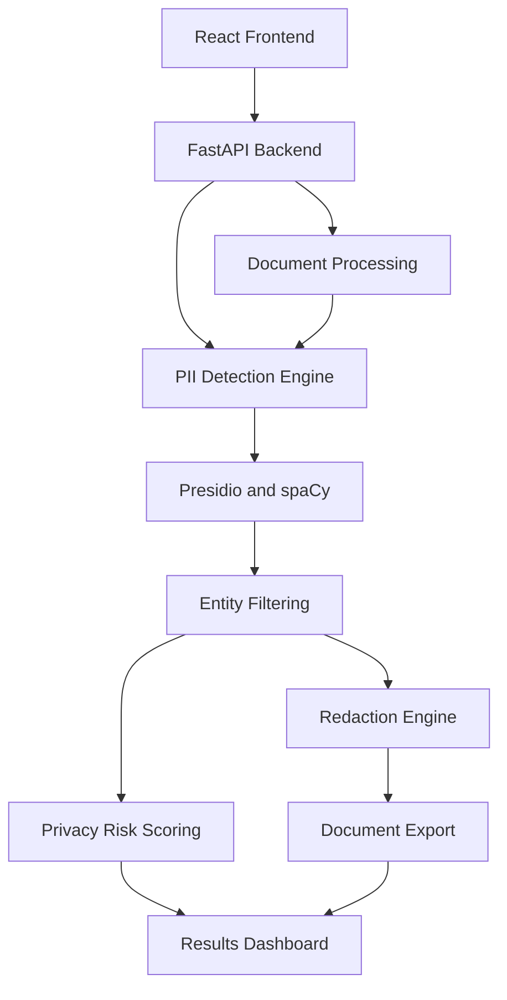

# PrivacyLens AI

### AI-Powered Sensitive Data Detection and Privacy Protection Platform

PrivacyLens AI is a full-stack application designed to detect, analyze, and redact personally identifiable information (PII) from text and documents.

The platform combines natural language processing, pattern-based recognition, document processing, and privacy risk assessment to help users identify sensitive information and reduce accidental data exposure.

## Features

- AI-powered personally identifiable information detection
- Automatic sensitive information redaction
- Privacy risk scoring
- TXT, PDF, and DOCX document uploads
- Sensitive entity identification
- Redacted document export in TXT, PDF, and DOCX formats
- Chunk-based processing for longer text
- Overlapping entity detection and deduplication
- Interactive React user interface
- RESTful API with interactive Swagger documentation

## Technology Stack

| Component | Technology |
|---|---|
| Frontend | React 19, JavaScript, HTML, CSS |
| Build Tool | Vite 8 |
| Backend | Python, FastAPI |
| NLP | Microsoft Presidio, spaCy |
| Document Processing | PyMuPDF, python-docx |
| API Server | Uvicorn |
| Testing | Pytest |
| Version Control | Git, GitHub |

## System Architecture



## Supported Sensitive Information

The application supports detection of sensitive information
such as:

- Personal names
- Email addresses
- Phone numbers
- Physical addresses
- Credit card numbers
- Social Security numbers
- URLs
- Custom identifiers
- Healthcare identifiers

## API Endpoints

| Method | Endpoint | Description |
|---|---|---|
| GET | / | API status |
| POST | /upload | Upload and extract document text |
| POST | /detect | Detect sensitive information |
| POST | /redact | Redact sensitive information |
| POST | /risk-score | Calculate privacy risk |
| POST | /export | Export redacted documents |

Interactive API documentation:

http://127.0.0.1:8000/docs

## Security and Privacy Controls

PrivacyLens AI implements multiple input validation
and document-processing safeguards:

- Maximum upload size of 10 MB
- Maximum extracted text length of 25,000 characters
- Maximum PDF length of 100 pages
- DOCX uncompressed archive limit of 50 MB
- DOCX archive entry restrictions
- File extension and signature validation
- Password-protected PDF rejection
- Early PDF text extraction limits
- Restricted CORS configuration
- Cache-control protection for sensitive API responses
- Server-side redaction before document export

These controls reduce common document-processing risks
but do not guarantee complete production security.

## Automated Testing

The project includes 40 passing automated tests
covering:

- Sensitive information detection
- Text redaction
- Privacy risk scoring
- REST API functionality
- Phone number format recognition
- Healthcare identifier conflicts
- Chunk boundary handling
- Duplicate entity removal
- False-positive regression testing
- Invalid file rejection
- Oversized DOCX archive rejection
- PDF page and text limits
- Password-protected PDF rejection

### Latest Test Results

| Metric | Result |
|---|---|
| Total Tests | 40 |
| Passed | 40 |
| Failed | 0 |
| Test Pass Rate | 100% |
| Execution Time | 3.43 seconds |
| Deprecation Warnings | 2 |

The test pass rate represents automated test results,
not real-world PII detection accuracy.

## Project Structure

```text
PrivacyLens-AI/
├── backend/
│   ├── main.py
│   ├── detector.py
│   ├── redactor.py
│   ├── risk_score.py
│   ├── chunk_processor.py
│   ├── overlap_filter.py
│   ├── file_processor.py
│   ├── document_exporter.py
│   └── requirements.txt
├── frontend/
│   ├── src/
│   ├── public/
│   └── package.json
├── tests/
│   ├── test_privacylens.py
│   ├── test_regressions.py
│   └── evaluation scripts
├── evaluation_reports/
├── .gitignore
└── README.md
```

## Installation and Setup

### Prerequisites

- Python
- Node.js
- npm
- Git

### Backend Setup

Open a terminal from the project root.

```powershell
cd backend
python -m venv .venv
.\.venv\Scripts\Activate.ps1
python -m pip install -r requirements.txt
python -m spacy download en_core_web_sm
cd ..
python -m uvicorn backend.main:app --reload
```

Backend URL:

http://127.0.0.1:8000

### Frontend Setup

Open a second terminal from the project root.

```powershell
cd frontend
npm install
npm run dev -- --host 127.0.0.1
```

Frontend URL:

http://127.0.0.1:5173

## Running Automated Tests

From the project root with the Python virtual
environment activated:

```powershell
python -m pytest tests/test_privacylens.py tests/test_regressions.py -v
```

## Use Cases

- Identifying sensitive information in documents
- Privacy-focused document sharing
- Data masking and anonymization assistance
- Reducing accidental disclosure of personal information
- Educational demonstrations of AI-powered privacy tools
- Supporting preliminary data privacy reviews

## Current Limitations

- Scanned PDFs requiring OCR are not supported.
- Detection may produce false positives or false negatives.
- Evaluation results do not guarantee real-world accuracy.
- Authentication and rate limiting are not implemented.
- Additional security hardening is required for public deployment.
- Redaction results should be reviewed before sharing documents.

## Future Enhancements

- OCR support for scanned documents
- Multilingual PII detection
- User authentication and authorization
- API rate limiting
- Docker containerization
- Cloud deployment
- Expanded independent evaluation
- CI/CD integration

## Author

**Lakshmi Deepika Yadagiri**

Master's Student in Computer Science  
University of North Texas

Interests: Software Engineering, Artificial Intelligence,
Full-Stack Development, and Data Engineering.

## Disclaimer

PrivacyLens AI is an educational and portfolio project.
It is not a certified compliance or enterprise security
solution. Users should independently verify redaction
results before sharing sensitive documents.


## Application Screenshots

### 1. Homepage
A modern and user-friendly interface for intelligent
privacy protection.


### 2. Document Upload
Upload TXT, PDF, and DOCX documents with automatic
text extraction.


### 3. Sensitive Data Detection
Identify sensitive personal information using AI,
NLP, and pattern-based recognition.


### 4. Automatic Redaction
Replace detected sensitive information with
protective placeholders.


### 5. Privacy Risk Assessment
Calculate a privacy risk score and classify
the risk level.


### 6. Document Export
Export redacted text in TXT, PDF, and DOCX formats.


## Automated Testing

| Metric | Result |
|---|---|
| Total Tests | 43 |
| Passed | 43 |
| Failed | 0 |
| Test Pass Rate | 100% |

The test pass rate represents automated test results,
not real-world sensitive data detection accuracy.
